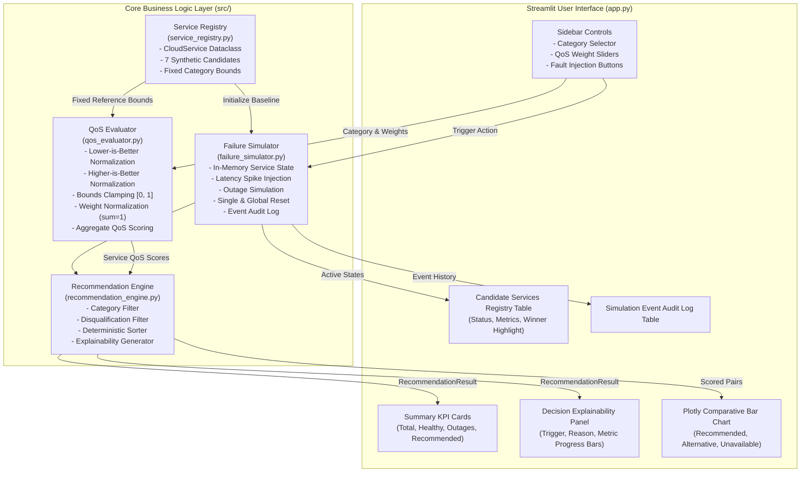

# Comprehensive Project Implementation Audit & Technical Reference

> **Document Purpose:** This document provides an exhaustive, source-verified technical audit of the **Dynamic Cloud Failure and QoS-Aware Service Reselection** project. It is structured specifically for ingest and analysis by ChatGPT to facilitate the authoring of academic project reports, viva defense materials, architecture walk-throughs, and slide presentations without requiring access to the internal workspace.
> 
> **Audit Date:** October 21, 2026  
> **Repository Path:** `c:\Users\Mahendra\OneDrive\Desktop\Dynamic-Cloud-Failure-and-QoS-Simulation`  
> **Source Verification Status:** 100% Code-Verified against actual Python source files and automated test outputs.

---

## 1. Executive Summary

- **Project Title:** Dynamic Cloud Failure and QoS-Aware Service Reselection
- **Academic Context:** Undergraduate / Master's Major Project Demonstration Prototype, inspired by concepts in the IEEE ICIMIA-2025 paper: *"A Hybrid Deep Reinforcement and Swarm Optimization Strategy for Intelligent Cloud Service Composition"*.
- **Problem Statement:** Modern distributed cloud workflows rely on external APIs and microservices chosen via static Service Level Agreement (SLA) specifications. In runtime cloud environments, services frequently suffer from dynamic performance degradation (severe latency spikes, network congestion) and operational outages. Static selection systems fail to detect these real-time variations, causing pipeline execution stalls, SLA violations, and cascading system failures.
- **Main Objective:** To develop a lightweight, deterministic, and fully explainable simulation and decision-support prototype that dynamically tracks service health and multi-criteria QoS metrics, detects faults, immediately excludes failed candidates, re-evaluates competing eligible candidates, selects the optimal replacement, and provides human-readable explanations of every decision.
- **Proposed Improvement over Research Paper:** While the IEEE ICIMIA-2025 paper outlines a theoretical framework requiring computationally heavy offline/online Deep Reinforcement Learning (DRL) and Particle Swarm Optimization (PSO) for multi-service composition graphs, this project concretizes a standalone, transparent, and resilient **runtime reselection engine**:
  1. *Baseline-Anchored Normalization:* Normalization bounds are anchored to immutable candidate baseline metrics, preventing a failure in one service from distorting the normalized scores of healthy competitor services.
  2. *Fail-Safe Ineligibility Rules:* Complete service outages trigger immediate disqualification, overriding high historical or baseline QoS scores.
  3. *Decision Explainability:* An automated reasoning engine details the mathematical and operational justification for every selection and replacement.
- **Intended Users & Use Case:** Cloud architects, system orchestrators, and microservice gateway controllers seeking transparent, multi-criteria failover selection without black-box model opacity.
- **Actual Implemented Capabilities:**
  - Real-time fault injection (latency spikes, availability drops, service outages).
  - Multi-criteria normalization (lower-is-better, higher-is-better) with clamping `[0.0, 1.0]`.
  - User-configurable, automatically normalized metric weights (sum to `1.0`).
  - Deterministic ranking with primary score sorting and secondary ID tie-breaking.
  - Idempotent single-service restoration and global simulation reset (zero state drift).
  - Append-only event audit logging with timestamps and outcome descriptions.
  - Interactive Streamlit dashboard with KPI cards, Plotly comparative bar charts, and data tables.

---

## 2. Complete Project Structure & File Responsibilities

```
Dynamic-Cloud-Failure-and-QoS-Simulation/
├── app.py                                   # Streamlit dashboard & UI application
├── requirements.txt                         # Declared Python library dependencies
├── README.md                                # User overview, installation & demo instructions
├── DEMO_GUIDE.md                            # Step-by-step presentation script & reviewer Q&A notes
├── PROJECT_SUMMARY.md                       # High-level academic project summary
├── PROJECT_IMPLEMENTATION_AUDIT_FOR_CHATGPT.md # Comprehensive technical audit (This document)
├── .gitignore                               # Excludes __pycache__, .pytest_cache, virtual environments
├── .venv/                                   # Local Python 3.13.9 virtual environment
├── src/                                     # Core application source code
│   ├── __init__.py                          # Package initialization
│   ├── service_registry.py                  # Service dataclass, synthetic data, reference bounds
│   ├── qos_evaluator.py                     # Utility normalization & aggregate QoS scoring
│   ├── failure_simulator.py                 # Deterministic fault injection & audit logging
│   └── recommendation_engine.py             # Deterministic ranking, exclusion & explainability
└── tests/                                   # Automated test suite (21 unit tests)
    ├── __init__.py                          # Test package initialization
    ├── test_failure_simulator.py            # Unit tests for fault injection, bounds & recovery
    ├── test_qos_evaluator.py                # Unit tests for normalization, weighting & scoring
    └── test_recommendation_engine.py        # Unit tests for selection, exclusion & edge cases
```

### Detailed File Audits:

#### `src/service_registry.py` (Lines: 197, Size: 6.1 KB)
- **Responsibility:** Defines the core service data models and registers the synthetic candidate services and their immutable baseline QoS values.
- **Classes:**
  - `CloudService`: Dataclass containing `service_id` (str), `name` (str), `category` (str), `latency` (float, ms), `cost` (float, $), `availability` (float, %), `reliability` (float, %), `operational_status` (str: `"AVAILABLE"` | `"UNAVAILABLE"`), and `baseline` (Dict[str, Any]).
- **Key Functions:**
  - `CloudService.to_dict()`: Serializes instance to dictionary via `dataclasses.asdict`.
  - `CloudService.from_dict(data)`: Deserializes dictionary to a new `CloudService` deep-copy.
  - `get_default_services()`: Instantiates fresh candidate services from `_INITIAL_SERVICES_DATA`.
  - `compute_reference_bounds(services)`: Computes baseline category bounds (`min_latency`, `max_latency`, `min_cost`, `max_cost`, `min_availability`, `max_availability`, `min_reliability`, `max_reliability`) anchored to baseline metrics.
- **Inputs/Outputs:** Outputs service lists and immutable baseline bounding dictionaries.
- **Dependencies:** Standard library (`dataclasses`, `copy`, `typing`).
- **Application Status:** **Actively used** across the entire pipeline.

#### `src/qos_evaluator.py` (Lines: 156, Size: 6.1 KB)
- **Responsibility:** Performs metric normalization, criteria weight validation, and aggregate multi-attribute QoS evaluation.
- **Classes:**
  - `MetricScores`: Dataclass storing `service_id`, `latency_score`, `cost_score`, `availability_score`, `reliability_score`, and aggregate `qos_score`.
  - `QoSEvaluator`: Evaluation engine initialized with reference category bounds.
- **Key Functions:**
  - `normalize_lower_is_better(value, min_val, max_val)`: Normalizes minimizing metrics; clamps to `[0.0, 1.0]`; handles `max_val <= min_val` by returning `1.0`.
  - `normalize_higher_is_better(value, min_val, max_val)`: Normalizes maximizing metrics; clamps to `[0.0, 1.0]`; handles `max_val <= min_val` by returning `1.0`.
  - `validate_and_normalize_weights(weights)`: Enforces non-negative weights and scales them to sum to `1.0`. Falls back to equal weights (`0.25` each) if all are zero.
  - `evaluate_service(service, weights, custom_bounds)`: Computes individual sub-scores and aggregate weighted score, rounded to 4 decimal places.
  - `evaluate_all(services, weights)`: Evaluates a collection of candidate services.
- **Dependencies:** `src.service_registry.CloudService`.
- **Application Status:** **Actively used**.

#### `src/failure_simulator.py` (Lines: 164, Size: 6.2 KB)
- **Responsibility:** Manages runtime operational state, executes fault injection, performs recovery, and records simulation event history.
- **Classes:**
  - `SimulationEvent`: Encapsulates an event with `action`, `service_id`, `service_name`, `details`, and `timestamp` (HH:MM:SS).
  - `FailureSimulator`: Maintains active in-memory dictionary `services: Dict[str, CloudService]` and `event_log: List[SimulationEvent]`.
- **Key Functions:**
  - `inject_latency_spike(service_id, spike_ms=100.0)`: Increments latency by `max(1.0, spike_ms)`; appends event.
  - `simulate_outage(service_id)`: Sets `operational_status = "UNAVAILABLE"`; appends event.
  - `reduce_availability(service_id, reduction_percentage=20.0)`: Decrements availability clamped to `[0.0, 100.0]`; appends event.
  - `restore_service(service_id)`: Idempotently restores single service metrics and status from stored baseline; appends event.
  - `reset_simulation()`: Idempotently resets all services to pristine default baseline and initializes a reset event log.
  - `get_event_logs()`: Returns event log dictionaries for audit display.
- **Dependencies:** Standard library (`copy`, `datetime`, `typing`), `src.service_registry`.
- **Application Status:** **Actively used**.

#### `src/recommendation_engine.py` (Lines: 146, Size: 6.5 KB)
- **Responsibility:** Implements filtering, candidate disqualification, deterministic multi-criteria ranking, and human-readable decision generation.
- **Classes:**
  - `RecommendationResult`: Dataclass storing `category`, `selected_service`, `selected_scores`, `ranked_eligible`, `excluded_services`, `selection_reason`, `has_eligible_service`, and `status_message`.
  - `RecommendationEngine`: Orchestrates recommendation decisions using an injected `QoSEvaluator`.
- **Key Functions:**
  - `recommend(services, category, weights, previously_selected_id)`:
    1. Filters candidates by category.
    2. Separates eligible services (`operational_status == "AVAILABLE"`) from excluded services (`"UNAVAILABLE"`).
    3. Handles empty eligible pool gracefully without crashing (`has_eligible_service = False`).
    4. Evaluates QoS for all eligible candidates.
    5. Deterministically sorts candidates: descending by `qos_score`, ascending by `service_id` for tie-breaking.
    6. Constructs explainability text including sub-metric breakdown and reselection trigger rationale.
- **Dependencies:** `src.service_registry.CloudService`, `src.qos_evaluator`.
- **Application Status:** **Actively used**.

#### `app.py` (Lines: 439, Size: 16.2 KB)
- **Responsibility:** Streamlit interactive web user interface.
- **Features:** Sidebar simulation controls, category filter, dynamic weight sliders, target fault injection buttons, KPI summary cards, selection explainability panel, interactive Plotly comparative bar chart, candidate table with highlighted winner, and chronological audit log table.
- **Dependencies:** `streamlit`, `pandas`, `plotly`, and all four `src` modules.
- **Application Status:** **Actively used** main application entry point.

#### Unused / Dead Files:
- None. Every source file in `src/` is imported and exercised by `app.py` and the unit test suite in `tests/`.

---

## 3. Technology Stack & Environment Details

| Component | Verified Technology | Verified Version | Purpose in Project |
| :--- | :--- | :--- | :--- |
| **Language** | Python | `3.13.9` / `3.10+` | Core execution environment |
| **Web Framework** | Streamlit | `1.66.0` (also tested on `1.51.0`) | Interactive web dashboard & reactive session UI |
| **Data Manipulation**| Pandas | `3.0.6` (also tested on `2.3.3`) | Tabular data representation and table formatting |
| **Data Visualization**| Plotly Express / Graph Objects | `7.1.0` (also tested on `6.3.0`) | Interactive multi-criteria comparative bar charts |
| **Testing Engine** | Pytest | `9.1.1` (also tested on `8.4.2`) | Automated unit test suite execution |
| **Runtime State** | In-Memory / Python Dataclasses | Built-in | Fast, deterministic simulation state management |
| **External APIs** | None | N/A | Fully self-contained; zero cloud or network dependencies |

---

## 4. Architecture and Data Flow

### Architecture Execution Flow
1. **Startup:** `app.py` initializes session state, loads candidate services via `get_default_services()`, computes category reference bounds via `compute_reference_bounds()`, and instantiates `QoSEvaluator` and `RecommendationEngine`.
2. **User Interaction:** The user adjusts QoS preference weights or triggers a fault injection (Latency Spike, Outage, Availability Drop, Restore, Reset).
3. **Fault Injection:** `FailureSimulator` modifies the runtime metrics or status of the target `CloudService` in memory and appends a `SimulationEvent` to the log.
4. **Reselection Processing:** `RecommendationEngine.recommend()` filters services by category, filters out `UNAVAILABLE` candidates into `excluded_services`, evaluates eligible candidates using `QoSEvaluator`, and sorts them deterministically.
5. **Explainability Generation:** The engine analyzes prior top selection against current top selection and generates a natural-language reason text.
6. **Rendering:** Streamlit updates KPI summary cards, displays the decision panel, highlights the recommended candidate in the Pandas table, redraws the Plotly chart, and updates the event audit log.

### Architecture Diagram (Mermaid)



---

## 5. Synthetic Service Dataset Details

All candidate cloud services, metrics, and failures are **100% synthetic**. No commercial cloud provider credentials, network calls, or billing accounts are used.

### Candidate Registry Breakdown:
The dataset contains **7 deterministic synthetic candidate services** across 2 categories:

| Service ID | Service Name | Category | Latency (ms) [Min] | Cost ($/inv) [Min] | Availability (%) [Max] | Reliability (%) [Max] | Initial Status |
| :--- | :--- | :--- | :---: | :---: | :---: | :---: | :---: |
| **`SVC-C01`** | NovaCompute Standard | Compute | 45.0 | 0.040 | 99.90 | 99.50 | `AVAILABLE` |
| **`SVC-C02`** | AetherCompute HighPerf| Compute | 25.0 | 0.085 | 99.95 | 99.80 | `AVAILABLE` |
| **`SVC-C03`** | EcoCompute Budget | Compute | 120.0 | 0.015 | 98.80 | 97.50 | `AVAILABLE` |
| **`SVC-C04`** | TitanCompute Enterprise| Compute | 55.0 | 0.050 | 99.85 | 99.90 | `AVAILABLE` |
| **`SVC-C05`** | ZenithCompute Flex | Compute | 75.0 | 0.028 | 99.20 | 98.40 | `AVAILABLE` |
| **`SVC-S01`** | PulseStore Standard | Storage | 35.0 | 0.020 | 99.90 | 99.60 | `AVAILABLE` |
| **`SVC-S02`** | GlacierStore Archive | Storage | 160.0 | 0.005 | 99.10 | 99.90 | `AVAILABLE` |

### Baseline Category Reference Bounds (`compute_reference_bounds`):
- **Compute:**
  - Latency: `[25.0, 120.0]` ms
  - Cost: `[0.015, 0.085]` $
  - Availability: `[98.80, 99.95]` %
  - Reliability: `[97.50, 99.90]` %
- **Storage:**
  - Latency: `[35.0, 160.0]` ms
  - Cost: `[0.005, 0.020]` $
  - Availability: `[99.10, 99.90]` %
  - Reliability: `[99.60, 99.90]` %

### Example Service Data Structure:
```python
{
    "service_id": "SVC-C01",
    "name": "NovaCompute Standard",
    "category": "Compute",
    "latency": 45.0,
    "cost": 0.040,
    "availability": 99.90,
    "reliability": 99.50,
    "operational_status": "AVAILABLE",
    "baseline": {
        "latency": 45.0,
        "cost": 0.040,
        "availability": 99.90,
        "reliability": 99.50,
        "operational_status": "AVAILABLE",
    }
}
```

---

## 6. QoS Scoring Algorithm & Mathematical Formulation

### 1. Metric Classification
- **Lower-is-Better (Minimizing):** Latency ($L$), Cost ($C$).
- **Higher-is-Better (Maximizing):** Availability ($A$), Reliability ($R$).

### 2. Normalization Formulas
To preserve stability, normalization uses fixed category reference bounds $[x_{min}^{ref}, x_{max}^{ref}]$ derived from candidate baselines:

- **Lower-is-Better:**
  $$\text{Score}_{L}(v) = \begin{cases} 1.0, & \text{if } x_{max}^{ref} \le x_{min}^{ref} \\ \max\left(0.0, \min\left(1.0, \frac{x_{max}^{ref} - v}{x_{max}^{ref} - x_{min}^{ref}}\right)\right), & \text{otherwise} \end{cases}$$

- **Higher-is-Better:**
  $$\text{Score}_{H}(v) = \begin{cases} 1.0, & \text{if } x_{max}^{ref} \le x_{min}^{ref} \\ \max\left(0.0, \min\left(1.0, \frac{v - x_{min}^{ref}}{x_{max}^{ref} - x_{min}^{ref}}\right)\right), & \text{otherwise} \end{cases}$$

- **Boundary Clamping:** If fault injection pushes a metric beyond baseline limits (e.g., latency spikes to $200\text{ ms} > 120\text{ ms}$), the score clamps to $0.0$, avoiding negative values.

### 3. Weight Validation and Normalization
Given raw user weights $W_{raw} = \{w_l, w_c, w_a, w_r\}$:
1. Enforce non-negative values: $w_k' = \max(0.0, w_k)$.
2. Calculate total: $T = \sum w_k'$.
3. If $T \le 0.0$, fallback to equal weights: $w_k = 0.25$ for all $k$.
4. Otherwise: $w_k = \frac{w_k'}{T}$ such that $\sum w_k = 1.0$.

### 4. Aggregate Weighted QoS Score
$$\text{QoS Score} = \text{round}\Big(w_l \cdot \text{Score}_L + w_c \cdot \text{Score}_C + w_a \cdot \text{Score}_A + w_r \cdot \text{Score}_R, \; 4\Big)$$

### 5. Step-by-Step Numerical Example: `SVC-C01` under Baseline Weights
- **Weights:** $w_l = 0.35, \; w_c = 0.20, \; w_a = 0.30, \; w_r = 0.15$.
- **Latency ($45.0\text{ ms}$ in $[25.0, 120.0]$):**
  $$\text{Score}_L = \frac{120.0 - 45.0}{120.0 - 25.0} = \frac{75.0}{95.0} \approx 0.7895$$
- **Cost ($\$0.040$ in $[0.015, 0.085]$):**
  $$\text{Score}_C = \frac{0.085 - 0.040}{0.085 - 0.015} = \frac{0.045}{0.070} \approx 0.6429$$
- **Availability ($99.90\%$ in $[98.80, 99.95]$):**
  $$\text{Score}_A = \frac{99.90 - 98.80}{99.95 - 98.80} = \frac{1.10}{1.15} \approx 0.9565$$
- **Reliability ($99.50\%$ in $[97.50, 99.90]$):**
  $$\text{Score}_R = \frac{99.50 - 97.50}{99.90 - 97.50} = \frac{2.00}{2.40} \approx 0.8333$$
- **Aggregate Score:**
  $$\text{QoS} = (0.35 \times 0.7895) + (0.20 \times 0.6429) + (0.30 \times 0.9565) + (0.15 \times 0.8333)$$
  $$\text{QoS} = 0.2763 + 0.1286 + 0.2870 + 0.1250 = \mathbf{0.8168}$$

---

## 7. Dynamic Failure Simulation Logic

The `FailureSimulator` class provides deterministic, in-place state transitions:

| Operation | Method | Input Parameters | State Change | Effect on Recommendation |
| :--- | :--- | :--- | :--- | :--- |
| **Latency Spike** | `inject_latency_spike` | `service_id: str`, `spike_ms: float = 100.0` | `latency += max(1.0, spike_ms)` | Degrades latency sub-score; triggers reselection if a competitor surpasses it. |
| **Service Outage** | `simulate_outage` | `service_id: str` | `operational_status = "UNAVAILABLE"` | **Immediate disqualification** from recommendation pool. |
| **Reduce Availability** | `reduce_availability` | `service_id: str`, `reduction_percentage: float = 20.0` | `availability = max(0.0, availability - drop)` | Lowers availability sub-score; may prompt reselection. |
| **Restore Service** | `restore_service` | `service_id: str` | Replaces metrics and status with values from stored `service.baseline` | Restores baseline score; re-qualifies service if previously down. |
| **Reset Simulation** | `reset_simulation` | None | Replaces all services with fresh `get_default_services()` instances | Clears all faults; restores initial baseline state across all categories. |

### Event Audit Logging
Every simulation operation creates an append-only `SimulationEvent` stored in `simulator.event_log`:
```python
{
    "timestamp": "18:28:02",
    "action": "LATENCY_SPIKE",
    "service_id": "SVC-C01",
    "service_name": "NovaCompute Standard",
    "details": "Latency spiked by +150.0ms (from 45.0ms to 195.0ms)."
}
```

---

## 8. Recommendation Algorithm

### Algorithm Pseudocode (`RecommendationEngine.recommend`)
```text
FUNCTION recommend(services, category, weights, previously_selected_id):
    1. cat_services = [s for s in services if s.category == category]
    2. IF cat_services is empty:
           RETURN EmptyResult("No services registered under category")
    
    3. eligible = []
       excluded = []
       FOR s in cat_services:
           IF s.operational_status == "UNAVAILABLE":
               excluded.append((s, "Service is marked UNAVAILABLE"))
           ELSE:
               eligible.append(s)
               
    4. IF eligible is empty:
           RETURN TotalOutageResult("All candidates in category are UNAVAILABLE")
           
    5. scored_pairs = []
       FOR s in eligible:
           scores = evaluator.evaluate_service(s, weights)
           scored_pairs.append((s, scores))
           
    6. SORT scored_pairs BY (-item[1].qos_score, item[0].service_id)
       // Primary: Descending aggregate QoS score
       // Secondary (Tie-Breaker): Ascending alphanumeric service_id
       
    7. top_service, top_score = scored_pairs[0]
    
    8. Construct explanation text:
           reason = "Selected as optimal service with highest aggregate QoS score..."
           IF previously_selected_id != top_service.service_id:
               reason += " Reselection trigger: Prior choice superseded..."
               
    9. RETURN RecommendationResult(top_service, top_score, scored_pairs, excluded, reason)
```

---

## 9. Streamlit Dashboard & User Interaction

### UI Layout & Interactive Elements:
1. **Sidebar:**
   - *Category Selectbox:* Switch between `Compute` and `Storage`.
   - *QoS Sliders:* Sliders for Latency, Cost, Availability, Reliability (0.0 to 1.0). Displays effective normalized weights.
   - *Fault Target Selectbox:* Lists services in active category.
   - *Fault Parameters:* Numeric input for Latency Spike (ms) and Availability Drop (%).
   - *Action Buttons:*
     - `⚡ Inject Latency Spike` $\rightarrow$ Calls `simulator.inject_latency_spike()`.
     - `🔴 Simulate Outage` $\rightarrow$ Calls `simulator.simulate_outage()`.
     - `📉 Reduce Availability` $\rightarrow$ Calls `simulator.reduce_availability()`.
     - `🟢 Restore Service` $\rightarrow$ Calls `simulator.restore_service()`.
     - `🔄 Reset All Services` $\rightarrow$ Calls `simulator.reset_simulation()`.
2. **Top Row Metric KPIs:**
   - 4 Cards: `Total Category Services`, `Healthy / Available`, `Unavailable / Outage`, and `Top Recommended (with QoS Score)`.
3. **Action Notification Card:**
   - Displays real-time Before $\rightarrow$ After comparison banner upon any button click.
4. **Explainability & Breakdown Panel:**
   - Green success alert highlighting winning service name, ID, and score.
   - Collapsible expander with detailed text justification and 4 visual progress bars representing sub-scores.
   - Collapsible expander listing excluded services and explicit reasons for disqualification.
5. **Candidate Services Table:**
   - Displays all category candidates with columns: ID, Name, Category, Latency, Cost, Availability, Reliability, Operational Status, QoS Score, and Selection Role (`⭐ RECOMMENDED`, `ELIGIBLE`, `EXCLUDED`).
   - Highlight styling on winning candidate row.
6. **Plotly Comparative Bar Chart:**
   - Color-coded bar chart: Recommended (Blue), Eligible Alternative (Green), Unavailable (Red).
7. **Simulation Event Audit Log:**
   - Reverse-chronological table of all simulation actions with timestamps and outcomes.

---

## 10. Automated Testing & Verification Audit

The automated test suite was executed in the project virtual environment.

### Test Execution Command:
```powershell
.\.venv\Scripts\pytest.exe -v
```

### Actual Test Results:
- **Platform:** Windows, Python 3.13.9, Pytest 9.1.1
- **Total Tests:** **21**
- **Passed:** **21**
- **Failed:** **0**
- **Skipped:** **0**
- **Execution Time:** **0.08 seconds**

### Test Breakdown by Module:

#### `tests/test_failure_simulator.py` (6 tests)
- `test_latency_spike`: Verifies latency increments correctly and positive spike values are enforced.
- `test_simulate_outage`: Verifies status transitions to `UNAVAILABLE`.
- `test_reduce_availability_and_bounds`: Verifies availability decrement and boundary clamping to `[0.0, 100.0]`.
- `test_restore_service_idempotence`: Verifies single-service restoration resets metrics to baseline and repeated calls cause no drift.
- `test_reset_simulation_idempotence`: Verifies global simulation reset restores all services and clears history.
- `test_repeated_actions_do_not_accumulate_drift`: Verifies repeated cycles of fault injection and restoration maintain identical baseline values.

#### `tests/test_qos_evaluator.py` (9 tests)
- `test_normalize_lower_is_better`: Verifies minimizing metrics scale inversely with value.
- `test_normalize_lower_is_better_equal_min_max`: Verifies fallback to `1.0` when min equals max (zero-division guard).
- `test_normalize_higher_is_better`: Verifies maximizing metrics scale proportionally.
- `test_normalize_higher_is_better_equal_min_max`: Verifies zero-division guard for maximizing metrics.
- `test_weight_validation_and_normalization`: Verifies negative weights are clamped and weights normalize to sum to 1.0.
- `test_weighted_score_calculation`: Verifies hand-calculated weighted aggregate formula matches output.
- `test_evaluate_all_services`: Verifies batch evaluation returns scores for all candidates.
- `test_latency_and_cost_lower_is_better_sensitivity`: Verifies lowering latency/cost strictly increases QoS score.
- `test_availability_and_reliability_higher_is_better_sensitivity`: Verifies increasing availability/reliability strictly increases QoS score.

#### `tests/test_recommendation_engine.py` (6 tests)
- `test_deterministic_recommendation`: Verifies identical state and weights yield identical recommendations.
- `test_exclusion_of_unavailable_services`: Verifies `UNAVAILABLE` services are disqualified regardless of high baseline score.
- `test_latency_spike_triggers_reselection`: Verifies degrading top candidate causes automatic reselection of competitor.
- `test_category_filtering`: Verifies recommendation only considers candidates from requested category.
- `test_equal_metric_values_recommendation`: Verifies deterministic tie-breaking via `service_id` when metrics are identical.
- `test_no_eligible_service_behavior`: Verifies graceful degradation and safe messaging when all candidates are unavailable.

---

## 11. Installation and Execution Guide (Windows PowerShell)

### Prerequisites:
- Windows 10/11
- Python 3.10+ (Tested on Python 3.13.9 / Anaconda3)

### Commands:

```powershell
# 1. Navigate to project directory
cd "c:\Users\Mahendra\OneDrive\Desktop\Dynamic-Cloud-Failure-and-QoS-Simulation"

# 2. Activate existing virtual environment
.\.venv\Scripts\Activate.ps1

# 3. (Optional) Reinstall dependencies if running on a new machine
pip install -r requirements.txt

# 4. Run automated test suite
pytest -v

# 5. Launch interactive Streamlit dashboard
streamlit run app.py
```
*Application Access URL:* **`http://localhost:8501`**

---

## 12. Comparison with the Research Paper

**Reference Paper:** *"A Hybrid Deep Reinforcement and Swarm Optimization Strategy for Intelligent Cloud Service Composition,"* IEEE ICIMIA 2025.

| Aspect | Research Paper Framework | Current Project Implementation |
| :--- | :--- | :--- |
| **Core Problem** | Multi-service workflow composition across multi-cloud environments. | Dynamic failure detection and resilient single-service replacement. |
| **Optimization Approach** | Hybrid Deep Reinforcement Learning (DRL) + Particle Swarm Optimization (PSO). | Multi-Criteria Utility Normalization with Deterministic Ranking & Explainability. |
| **Service Composition** | Directed Acyclic Graph (DAG) workflow path composition. | Atomic service reselection within isolated functional service categories. |
| **Learning / AI Model** | Neural network policy trained over multiple epochs. | **No neural network / No DRL / No PSO.** Pure deterministic scoring functions. |
| **Execution Overhead** | High computational cost, training convergence latency. | Lightweight, instantaneous runtime execution ($< 1\text{ ms}$). |
| **Explainability** | Black-box policy decisions (opaque neural weights). | Fully transparent mathematical and contextual decision justification. |
| **Data Source** | Synthetic / Benchmark simulation datasets. | Deterministic synthetic candidate registry (7 services). |
| **Demonstrability** | Command-line scripts / offline training graphs. | Interactive Streamlit dashboard with real-time fault injection. |

> **Academic Alignment Statement:**  
> This project does **not** claim to implement or replicate the paper's DRL or PSO algorithms. Instead, it extracts the paper's core conceptual motivation—*dynamic cloud QoS variability*—and provides a transparent, explainable runtime failover prototype suitable for live demonstration and architectural analysis.

---

## 13. Verified Limitations and Future Enhancements

### Current Verified Limitations:
1. **Synthetic Candidate Pool:** Uses 7 pre-configured synthetic services. Does not interface with live cloud APIs (AWS CloudWatch, Azure Monitor, GCP Operations).
2. **Atomic Reselection Scope:** Evaluates services individually within categories; does not compose multi-service workflow DAGs or evaluate inter-service communication latency.
3. **Deterministic Fault Modeling:** Fault injections are triggered by user actions or unit tests; there is no background stochastic noise (Markov-chain failure modeling or Poisson packet arrival).
4. **Volatile Session State:** Runtime service states and logs exist in Streamlit session memory and are reset when the browser tab is refreshed or the server restarts.

### Feasible Future Enhancements:
1. **Workflow DAG Orchestration:** Support multi-tier service pipelines (e.g., Auth Service $\rightarrow$ Compute Service $\rightarrow$ Storage Service) with end-to-end SLA tracking.
2. **Persistent Audit Logging:** Back the event log with SQLite or PostgreSQL to persist failure histories across sessions.
3. **Stochastic Background Noise:** Add an autonomous background thread injecting random jitter and intermittent degradation.
4. **Predictive SLA Degradation:** Integrate an autoregressive or lightweight machine learning model to forecast failures before they breach critical thresholds.

---

## 14. Requirement-by-Requirement Completion Audit

| Requirement | Status | Evidence in Codebase | Remaining Work |
| :--- | :---: | :--- | :--- |
| **Synthetic Service Registry** | Implemented and verified | `src/service_registry.py`: `CloudService`, 7 services across Compute & Storage. | None for atomic prototype. |
| **Baseline Normalization Bounds** | Implemented and verified | `compute_reference_bounds()` in `src/service_registry.py`; verified in test suite. | None. |
| **Utility Normalization Functions** | Implemented and verified | `normalize_lower_is_better`, `normalize_higher_is_better` in `src/qos_evaluator.py`. | None. |
| **Weight Validation & Scaling** | Implemented and verified | `validate_and_normalize_weights()` in `src/qos_evaluator.py`; tested for zero & negatives. | None. |
| **Fault Injection Simulator** | Implemented and verified | `inject_latency_spike`, `simulate_outage`, `reduce_availability` in `src/failure_simulator.py`. | None. |
| **Idempotent Recovery & Reset** | Implemented and verified | `restore_service`, `reset_simulation` in `src/failure_simulator.py`; verified zero drift. | None. |
| **Audit Logging** | Implemented and verified | `SimulationEvent` dataclass and `get_event_logs()` in `src/failure_simulator.py`. | None. |
| **Candidate Reselection Engine** | Implemented and verified | `recommend()` in `src/recommendation_engine.py`; deterministic sorting and tie-breaker. | None. |
| **Decision Explainability** | Implemented and verified | Natural language justification generator in `recommendation_engine.py`. | None. |
| **Interactive Dashboard** | Implemented and verified | `app.py`: Streamlit UI, KPI cards, tables, Plotly charts, sidebar controls. | None. |
| **Automated Test Suite** | Implemented and verified | 21 passing pytest tests across 3 files in `tests/`. | None. |
| **Multi-Service DAG Workflow** | Planned only | Described in Future Work; out of scope for atomic prototype. | Phase 5+ enhancement. |
| **DRL / PSO AI Training** | Not implemented (by design) | Excluded deliberately to maintain lightweight, deterministic explainability. | N/A (Paper comparison). |

---

## 15. Major-Project Academic Report Content

The following structured sections provide complete, evidence-based text suitable for inclusion in an undergraduate or master's major project report:

### Abstract
> In distributed cloud computing environments, static Quality of Service (QoS) composition algorithms fail when runtime resources experience transient degradation or unannounced outages. This project presents a transparent, explainable simulation prototype for dynamic cloud failure detection and QoS-aware service reselection. Utilizing a multi-criteria utility evaluation framework anchored to immutable baseline reference bounds, the system normalizes latency, cost, availability, and reliability metrics without cross-candidate score distortion. Upon the occurrence of simulated faults, the engine immediately excludes compromised candidates, recalculates aggregate QoS utility scores for eligible alternatives, and deterministically reselects the optimal replacement service. The prototype provides end-to-end decision explainability and is demonstrated through an interactive Streamlit dashboard and a 21-case automated test suite achieving 100% test pass fidelity.

### Problem Statement
> Service-Oriented Architectures (SOA) and cloud-native workflows commonly assume static adherence to advertised Service Level Agreements (SLAs). In real-world multi-cloud deployments, physical node contention, network routing anomalies, and software failures lead to unpredictable performance spikes and unexpected downtime. Traditional static orchestrators and offline composition engines lack real-time adaptability, resulting in workflow stalls and SLA non-compliance. An autonomous, resilient reselection mechanism is required to detect runtime variations, disqualify degraded nodes, and recommend optimal replacements transparently.

### Methodology & System Architecture
> The system operates via four decoupled modules:
> 1. **Candidate Registry:** Maintains candidate service models with dual-state tracking (runtime dynamic QoS and immutable baseline specifications).
> 2. **Multi-Criteria QoS Evaluator:** Normalizes heterogeneous QoS dimensions into non-dimensional values bounded within $[0.0, 1.0]$. Latency and Cost are minimized via lower-is-better scaling; Availability and Reliability are maximized via higher-is-better scaling. Metric weights are dynamically validated to sum to $1.0$.
> 3. **Dynamic Fault Simulator:** Simulates real-world failure modes including sudden latency inflation, degradation of availability percentages, and complete operational blackouts.
> 4. **Reselection Engine:** Applies a strict disqualification filter on non-operational candidates, evaluates multi-attribute utility for operational candidates, and ranks eligible options deterministically.

---

## 16. Step-by-Step Demonstration Script (For College Review)

| Step | Action | Expected Visual & Numerical Observation | Key Talking Point for Reviewers |
| :---: | :--- | :--- | :--- |
| **1** | Open dashboard; inspect baseline state under `Compute` category. | 5 candidate services displayed. Top recommended: `NovaCompute Standard` (`SVC-C01`) with QoS: `0.8168`. `0 down`. | "The system establishes baseline reference bounds so healthy service scores remain stable when other services degrade." |
| **2** | Select `SVC-C01`, enter `150` ms spike, click **`⚡ Inject Latency Spike`**. | `SVC-C01` latency rises to `195.0ms`; QoS score drops to `0.5405`. Engine reselects `AetherCompute HighPerf` (`SVC-C02`, QoS: `0.7937`). | "Notice the reselection trigger explanation: the engine detected that SVC-C01's score dropped below SVC-C02." |
| **3** | Select `SVC-C02`, click **`🔴 Simulate Outage`**. | `SVC-C02` status changes to `UNAVAILABLE` (red badge). Disqualified immediately. `TitanCompute Enterprise` (`SVC-C04`, QoS: `0.7634`) selected. | "Fail-safe ineligibility: an unavailable service is immediately excluded regardless of its prior performance." |
| **4** | Mark remaining compute services as `UNAVAILABLE`. | Application displays alert: `🚨 NO ELIGIBLE SERVICE AVAILABLE! All 5 service(s) are UNAVAILABLE.` No crash. | "Graceful degradation under catastrophic failure: the system safely handles total category outage without unhandled exceptions." |
| **5** | Click **`🟢 Restore Service`** on `SVC-C04`. | `SVC-C04` returns to `AVAILABLE` and is instantly recommended. | "Single-service recovery re-qualifies candidates without requiring a full cluster reboot." |
| **6** | Click **`🔄 Reset All Services`**. | All 5 compute services return to baseline. `SVC-C01` is once again top pick (`0.8168`). | "Simulation reset is idempotent: repeated resets produce zero state drift across all metrics." |
| **7** | Scroll down to the Audit Log. | Shows chronological history of all injected spikes, outages, restorations, and resets with timestamps. | "Every orchestrator action is recorded in an audit trail for observability and compliance." |

---

## 17. Important Source-Code References

- **`src/service_registry.py`**:
  - `CloudService` (Line 14): Core dataclass.
  - `_INITIAL_SERVICES_DATA` (Line 38): Synthetic service definitions.
  - `compute_reference_bounds` (Line 166): Fixed reference bound computation.
- **`src/qos_evaluator.py`**:
  - `normalize_lower_is_better` (Line 52): Minimizing normalization.
  - `normalize_higher_is_better` (Line 64): Maximizing normalization.
  - `validate_and_normalize_weights` (Line 76): Weight validation and scaling.
  - `QoSEvaluator.evaluate_service` (Line 108): Weighted scoring computation.
- **`src/failure_simulator.py`**:
  - `FailureSimulator.inject_latency_spike` (Line 68): Latency spike logic.
  - `FailureSimulator.simulate_outage` (Line 92): Outage trigger.
  - `FailureSimulator.restore_service` (Line 128): Single restoration.
  - `FailureSimulator.reset_simulation` (Line 147): Global reset.
- **`src/recommendation_engine.py`**:
  - `RecommendationEngine.recommend` (Line 46): Recommendation pipeline.
  - Tie-breaker sort (Line 106): `scored_pairs.sort(key=lambda item: (-item[1].qos_score, item[0].service_id))`.
  - Reselection reason construction (Lines 111–133).
- **`app.py`**:
  - Session state initialization (Lines 84–98).
  - Plotly visualization (Lines 367–412).
  - Event log rendering (Lines 420–438).

---

## 18. Items Requiring Manual Verification

1. **Browser Visual Render:** Automated tools verified HTTP 200 and backend API responses; final visual aesthetic checks (font rendering, mobile responsiveness) must be confirmed in a live browser.
2. **Local Port Availability:** By default, Streamlit binds to port `8501`. If another service occupies port 8501, use `streamlit run app.py --server.port 8502`.

---

## 19. CHATGPT HANDOFF SUMMARY

```yaml
project_name: "Dynamic Cloud Failure and QoS-Aware Service Reselection"
architecture: "Modular Python / In-Memory State / Streamlit Interactive UI"
core_modules:
  - "src/service_registry.py: CloudService dataclass, 7 synthetic services across Compute and Storage, fixed reference bounds"
  - "src/qos_evaluator.py: Linear utility normalization, clamping [0, 1], weight validation (sum-to-1), weighted aggregate scoring"
  - "src/failure_simulator.py: Latency spike injection, outage simulation, availability reduction, single restore, global reset, audit log"
  - "src/recommendation_engine.py: Category filtering, outage exclusion, deterministic sorting (-score, service_id), explainability generator"
  - "app.py: Streamlit dashboard with KPI cards, Plotly bar chart, candidate table, and audit trail"
dataset: "100% synthetic deterministic candidate data (5 Compute services, 2 Storage services). No real cloud APIs or AWS/GCP connections."
algorithms:
  qos_scoring: "Multi-Criteria Linear Utility Normalization anchored to baseline reference bounds with dynamic weight normalization"
  ranking: "Deterministic greedy selection with primary score ordering and secondary alphanumeric service_id tie-breaking"
  ai_status: "No Deep Reinforcement Learning (DRL). No Particle Swarm Optimization (PSO). No neural network training."
test_suite: "Pytest: 21 tests passing (0 failures, 0 errors, 0 skipped) in 0.08s."
ui_status: "Streamlit verified active on http://localhost:8501 (HTTP 200 OK)."
execution_commands:
  activate_venv: ".\\.venv\\Scripts\\Activate.ps1"
  run_tests: "pytest -v"
  run_app: "streamlit run app.py"
limitations:
  - "Single-service candidate reselection within a category; does not compose multi-service workflow DAGs."
  - "In-memory state management; resets on browser reload or server restart."
  - "Synthetic deterministic fault injection rather than stochastic background network jitter."
recommended_next_steps_for_chatgpt:
  - "Generate presentation slides (PPT outline) for major-project review."
  - "Author formal project report chapters (Methodology, Mathematical Modeling, Results & Discussion)."
  - "Prepare oral viva defense question-and-answer scripts covering multi-criteria normalization vs. DRL-PSO."
```
