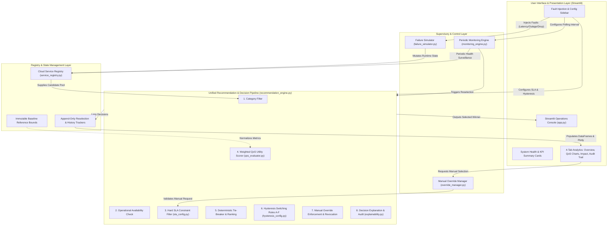
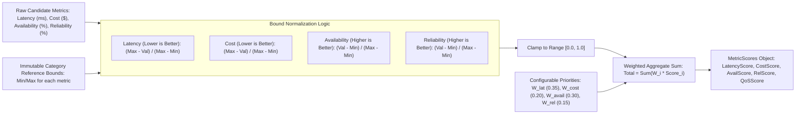
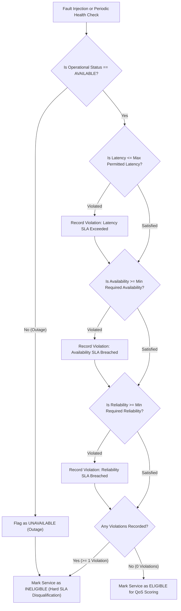
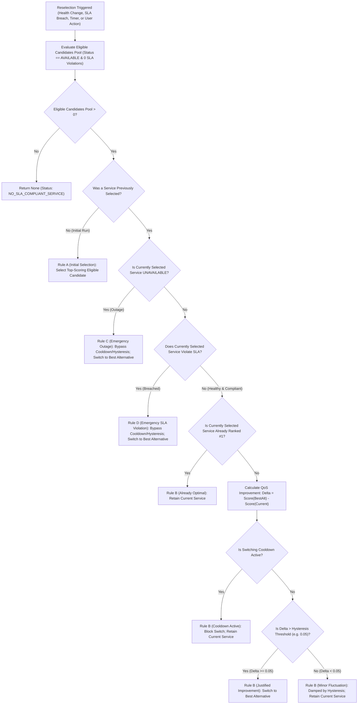
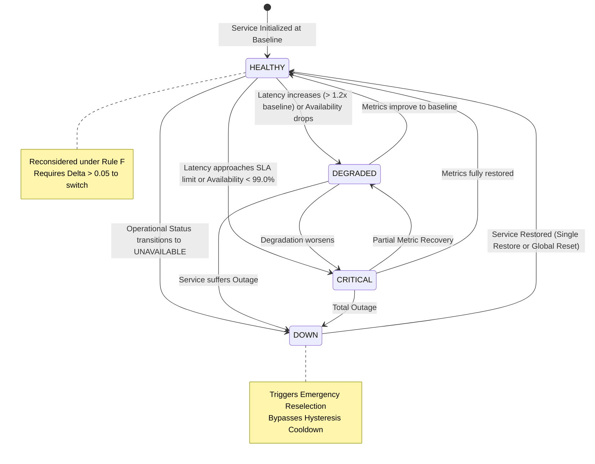

# System Architecture & Technical Design

**Project:** Dynamic Cloud Failure Detection and QoS-Aware Service Reselection  
**Document Classification:** Architectural Specification & Component Interaction Guide  
**Release Target:** Release Candidate (RC-1.0.0)  

---

## 1. Architectural Overview & Design Principles

The **Dynamic Cloud Failure Detection and QoS-Aware Service Reselection** system is designed as a modular, deterministic, and explainable software platform for evaluating cloud services, enforcing hard Service Level Agreement (SLA) constraints, suppressing service flapping, and automating emergency failover.

The architecture adheres to six core software engineering principles:
1. **Separation of Concerns:** Clear isolation between the candidate registry (`service_registry`), multi-criteria utility evaluation (`qos_evaluator`), SLA constraint filtering (`sla_config`), switching stability (`hysteresis_config`), background health surveillance (`monitoring_engine`), operator control (`override_manager`), and visualization (`app.py`, `analytics.py`).
2. **Immutable Baseline Reference Bounds:** Normalization bounds ($\min$ and $\max$ per category) are anchored to pre-computed baseline states. Degradation or failure in one candidate never warps or artificially inflates the normalized utility scores of competitor services.
3. **Multi-Stage Decision Pipeline:** Recommendation proceeds through a strict linear pipeline: `Category Filtering` $\to$ `Outage Disqualification` $\to$ `Hard SLA Validation` $\to$ `Multi-Attribute Utility Scoring` $\to$ `Deterministic Tie-Breaking` $\to$ `Hysteresis Switching Control` $\to$ `Manual Override Enforcement`.
4. **Hard Constraint Superiority:** SLA requirements represent non-negotiable boundaries evaluated *prior* to QoS scoring. High aggregate scores can never compensate for or bypass an SLA breach.
5. **Fail-Safe Emergency Bypass:** While normal performance-driven switching requires a significant improvement threshold ($\Delta Q \ge 0.05$) and respects cooldown timers, service outages and SLA breaches immediately trigger emergency reselection.
6. **Zero Memory Leaks & Linear Scalability:** All data structures use lightweight Python dataclasses, bounded history structures, and vectorized Pandas transformations, ensuring sub-20ms scalability to 1,000 services.

---

## 2. Overall System Architecture Diagram



---

## 3. Workflow Diagrams

### 3.1 QoS Evaluation Workflow

The evaluation engine scales multi-attribute raw metrics with different physical units into comparable $[0.0, 1.0]$ utility scores using baseline-anchored bounds:



---

### 3.2 Failure Detection Workflow

Failures are detected dynamically through runtime mutation inspection or background surveillance:



---

### 3.3 Dynamic Service Reselection Workflow (Hysteresis Decision Engine)

The decision engine applies formal rules (Rules A through F) to decide whether to retain the currently selected service or execute a switch:



---

### 3.4 Monitoring & Recovery Lifecycle Workflow

The background monitoring engine evaluates health transitions across the four-tier lifecycle:



---

### 3.5 Manual Override Operating Mode Workflow

Dual operating modes (`AUTOMATIC` and `MANUAL_OVERRIDE`) are governed with hard fail-safe protection:

```mermaid
sequenceDiagram
    autonumber
    actor Operator as Dashboard Operator
    participant UI as Streamlit Console
    participant Mgr as ManualOverrideManager
    participant Eng as RecommendationEngine
    participant Reg as CloudService Registry

    Note over Operator,Eng: Mode: AUTOMATIC (Algorithmic Selection)
    Operator->>UI: Selects candidate SVC-C04 and provides audit reason
    Operator->>UI: Clicks "Activate Manual Override"
    UI->>Mgr: request_manual_override(services, "Compute", "SVC-C04", sla, reason)
    Mgr->>Mgr: Validate existence, category, status == AVAILABLE, SLA compliance
    alt Validation Rejection (e.g. SLA violated or Outage)
        Mgr-->>UI: is_valid = False, Rejection Reason
        UI-->>Operator: Displays red error banner; Mode remains AUTOMATIC
    else Validation Success
        Mgr->>Mgr: Transition Mode to MANUAL_OVERRIDE; lock requested_id = SVC-C04
        Mgr->>Mgr: Log MANUAL_OVERRIDE_ACTIVATED event
        Mgr-->>UI: is_valid = True
        UI-->>Operator: Displays amber warning banner: Active Manual Override
    end

    Note over Operator,Reg: Runtime Fault Injected on SVC-C04
    Reg->>Reg: Latency spikes to 180ms (SLA Breach) or Outage strikes
    UI->>Eng: recommend(services, mode=MANUAL, manual_id=SVC-C04)
    Eng->>Eng: Detects active manual service violates SLA or is UNAVAILABLE
    Eng->>Eng: Set override_terminated = True
    Eng->>Mgr: clear_override("Emergency SLA Violation Revocation")
    Mgr->>Mgr: Transition Mode to AUTOMATIC; clear lock
    Eng->>Eng: Fall back to best eligible automatic candidate (SVC-C01)
    Eng-->>UI: Output recommendation with failover notice
    UI-->>Operator: Alert: Manual Override Terminated due to SLA breach
```

---

## 4. Component Interaction Matrix

| Subsystem Component | Inputs | Outputs | Primary Interfacing Modules |
| :--- | :--- | :--- | :--- |
| **`CloudService`** | Hardware/network parameters | Standardized service representation | All modules |
| **`QoSEvaluator`** | Service metrics, Category reference bounds, Weights | `MetricScores` (individual + composite score) | `recommendation_engine`, `analytics` |
| **`SLAConfig`** | Max latency, Min availability, Min reliability | Boolean eligibility, Violation string list | `recommendation_engine`, `override_manager` |
| **`HysteresisConfig`**| Improvement threshold ($\Delta Q$), Cooldown duration | Boolean switching permission | `recommendation_engine` |
| **`MonitoringEngine`**| Polling interval, Service registry, SLA config | Cycle summaries, Deduplicated events, Health states | `recommendation_engine`, `app.py` |
| **`ManualOverrideManager`**| Operator requested service ID, Audit reason | Operating mode, Override locks, Transition events | `recommendation_engine`, `app.py` |
| **`RecommendationEngine`**| Services pool, Category, SLA, Hysteresis, Override | `RecommendationResult` (Winner, Scores, Rationale)| `app.py`, `monitoring_engine`, `analytics` |
| **`FailureSimulator`** | Target service ID, Fault magnitude | Mutated `CloudService` runtime attributes | `service_registry`, `app.py` |
| **`Explainability`** | Candidate scores, Historical decisions | Markdown breakdowns, Comparison DataFrames | `app.py` |
| **`Analytics`** | Snapshot history, Simulation events | Plotly visual figures (Bar, Radar, Timeline) | `app.py` |
