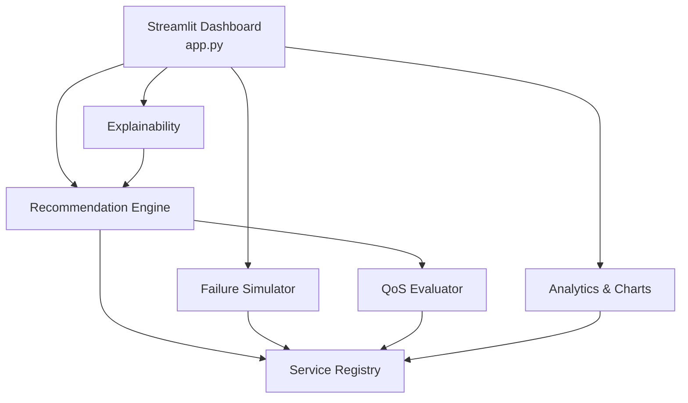

# Dynamic Cloud Failure Detection and QoS-Aware Service Reselection

A simulation-based cloud failure detection and QoS-aware service reselection platform developed as an academic capstone project.

> **Research Paper:** *Dynamic Cloud Failure Detection and QoS-Aware Service Reselection: A Simulation-Based Framework*

> **Academic Reference:** Inspired by IEEE ICIMIA-2025 — *A Hybrid Deep Reinforcement and Swarm Optimization Strategy for Intelligent Cloud Service Composition*

> **Important:** This is a **deterministic academic simulation**. It does not connect to live AWS, Azure, or Google Cloud infrastructure. All cloud services, QoS measurements, and failure events are synthetically generated.

---

## 1. Problem Statement

Modern cloud applications rely on distributed services and third-party APIs that can experience latency spikes, reduced availability, and complete outages. Traditional static service selection cannot react to dynamic runtime degradation, leading to SLA violations and cascading failures.

**Key challenges addressed:**
- Static SLA contracts fail under dynamic conditions
- Unconstrained QoS scoring ignores hard safety constraints
- Naive reactive systems cause service flapping
- Black-box optimization lacks transparency
- Fully autonomous systems prevent operator intervention

## 2. Objectives

1. **Multi-Attribute QoS Evaluation** — Score services using latency, cost, availability, and reliability with configurable weights
2. **Automatic Service Reselection** — Exclude unavailable services and select the best alternative
3. **Failure Simulation** — Inject latency spikes, availability degradation, and total outages
4. **Explainability** — Provide human-readable explanations for every recommendation decision
5. **Interactive Dashboard** — Professional Cloud Command Center for live demonstration

## 3. System Architecture



### Module Responsibilities

| Module | Responsibility |
| :--- | :--- |
| `service_registry.py` | CloudService data model, synthetic baselines, immutable reference bounds |
| `qos_evaluator.py` | Min-max normalization and weighted multi-criteria QoS scoring |
| `recommendation_engine.py` | Availability filtering, ranking, selection, and explanation generation |
| `failure_simulator.py` | Latency spike, availability degradation, outage, restoration, and reset |
| `analytics.py` | Plotly chart builders for QoS comparison and health distribution |
| `explainability.py` | Human-readable recommendation explanations and comparison tables |
| `app.py` | Streamlit Cloud Command Center dashboard |

## 4. Project Structure

```
DynamicCloudQoS/
├── app.py                    # Streamlit dashboard
├── service_registry.py       # Cloud service data model
├── qos_evaluator.py          # QoS normalization and scoring
├── recommendation_engine.py  # Service ranking and selection
├── failure_simulator.py      # Fault injection and restoration
├── analytics.py              # Plotly visualization builders
├── explainability.py         # Decision explanation generator
├── requirements.txt          # Python dependencies
├── README.md                 # This file
└── tests/
    ├── __init__.py
    └── test_qos.py           # Automated test suite
```

## 5. QoS Mathematical Formulas

### Min-Max Normalization

**Benefit-type metrics** (higher is better — Availability, Reliability):

$$U_{\text{benefit}}(x) = \frac{x - x_{\min}}{x_{\max} - x_{\min}}$$

**Cost-type metrics** (lower is better — Latency, Cost):

$$U_{\text{cost}}(x) = \frac{x_{\max} - x}{x_{\max} - x_{\min}}$$

### Weighted Aggregate Score

$$Q(s) = \sum_{i=1}^{n} w_i \times q_i(s)$$

**Default weights:** Latency = 0.35, Cost = 0.20, Availability = 0.30, Reliability = 0.15

### Baseline Reference Bounds

Normalization uses **immutable baseline bounds** (not live min/max), ensuring that fault injection on one service does not distort the scores of other services.

## 6. Research Paper Result Reproduction

The prototype reproduces the baseline experimental benchmark figures captured in the research paper:

| Parameter | Research Paper Benchmark | Prototype Output | Verification Status |
| :--- | :--- | :--- | :--- |
| **Initial Active Services** | 5 / 5 Healthy | 5 / 5 Healthy | Exact Match |
| **Selected Service** | NovaCompute Standard (`SVC-C01`) | NovaCompute Standard (`SVC-C01`) | Exact Match |
| **Aggregate QoS Score** | 0.8168 | 0.8168 | Exact Match |
| **Best Alternative (Runner-up)** | Aether Compute HighPerf (`SVC-C02`) | Aether Compute HighPerf (`SVC-C02`) | Exact Match |
| **Alternative QoS Score** | 0.7937 | 0.7937 | Exact Match |
| **Score Margin ($\Delta Q$)** | 0.0231 | 0.0231 | Exact Match |
| **Normalized Latency** | 0.79 | 0.79 (0.7851) | Exact Match |
| **Normalized Cost** | 0.64 | 0.64 (0.6429) | Exact Match |
| **Normalized Availability** | 0.96 | 0.96 (0.9615) | Exact Match |
| **Normalized Reliability** | 0.83 | 0.83 (0.8333) | Exact Match |

## 7. Failure Scenarios & One-Click Autonomous Failover

The simulation replaces cumbersome manual failure targeting with an intelligent, **one-click active failure engine**:

- **Active Service Targeting:** When the user clicks **"⚡ Simulate Cloud Failure"**, the platform automatically targets the currently recommended/active cloud service.
- **Immediate State Transition:** The active service transitions from `Healthy` to `Failed (UNAVAILABLE)`.
- **Autonomous Reselection:** The QoS engine immediately excludes the failed service, re-evaluates all remaining healthy candidates, and promotes the highest-scoring alternative (e.g., `SVC-C02 Aether Compute HighPerf`) to active status without requiring another click.
- **Before-and-After Audit Card:** The dashboard displays a 3-stage visual lifecycle showing the initial state, failure detection alert, and final autonomous reselection with full explainability.
- **Reversibility:** A **"🔧 Restore Failed Service"** button restores the failed service back to healthy status. The engine automatically re-promotes it only if its QoS score exceeds the current provider.
- **Global Reset:** A **"🔄 Reset Entire Simulation"** button restores all services back to baseline.

| Scenario / Action | Effect | Reversibility |
| :--- | :--- | :--- |
| **Simulate Cloud Failure** | Outage on active service (`UNAVAILABLE`) + immediate auto-reselection | Yes (Restore / Reset) |
| **Restore Failed Service** | Returns most recently failed service to `Healthy` state | Natural QoS re-ranking |
| **Reset Simulation** | Restores all registered services to baseline values | Baseline initial state |

## 8. Technologies Used

- **Python 3.10+** — Core language
- **Streamlit** — Interactive web dashboard
- **Pandas** — Data processing and table generation
- **NumPy** — Numerical calculations
- **Plotly** — Interactive charts and visualizations
- **Pytest** — Automated testing framework

## 9. Installation

```bash
# Clone or navigate to the project directory
cd DynamicCloudQoS

# Create and activate a virtual environment
python -m venv .venv

# Windows PowerShell
.\.venv\Scripts\Activate.ps1

# Install dependencies
pip install -r requirements.txt
```

## 10. Running the Application

```bash
streamlit run app.py
```

Open http://localhost:8501 in your browser.

## 11. Running Tests

```bash
pytest tests -v
```

## 12. Demonstration Script

### Step-by-step for academic review (One-Click Failover Flow):

1. **Launch** — `streamlit run app.py` → Dashboard loads with 5 healthy Compute services.
2. **Observe Initial State** — Point out `NovaCompute Standard (SVC-C01)` with QoS score **0.8168** as the active provider and `Aether Compute HighPerf (SVC-C02)` with **0.7937** as runner-up.
3. **One-Click Failure Simulation** — Click the prominent **"⚡ Simulate Cloud Failure"** button.
4. **Observe Before-and-After Lifecycle:**
   - **Stage 1 (Before Failure):** Shows `NovaCompute Standard` was healthy and active.
   - **Stage 2 (Failure Detected):** Shows `NovaCompute Standard` failed (`UNAVAILABLE`) with an immediate outage alert.
   - **Stage 3 (After Automatic Reselection):** Shows autonomous failover promoted `Aether Compute HighPerf (SVC-C02)` to active with confirmation message.
5. **Inspect Live Dashboard Updates:**
   - Active Recommendation Card updates to `Aether Compute HighPerf`.
   - KPI cards show 4 Healthy, 1 Unavailable.
   - Radar and ranking charts dynamically reflect the re-ranked pool.
   - **Simulation Event History** records the outage event with exact timestamp and reselection outcome.
6. **Restore Failed Service** — Click **"🔧 Restore Failed Service"**. Observe `NovaCompute Standard` returning to Healthy status and reclaiming active status based on its superior baseline QoS score.
7. **Reset** — Click **"🔄 Reset Entire Simulation"** to reset all states and clear history.

## 13. Limitations

- **Synthetic data only** — Does not connect to real cloud infrastructure
- **Single-node execution** — Runs locally, not in a distributed environment
- **No machine learning** — Uses deterministic mathematical scoring, not ML prediction
- **No authentication** — Single-operator console without RBAC
- **Simulation scope** — Fault injection uses deterministic deltas, not stochastic models


---


