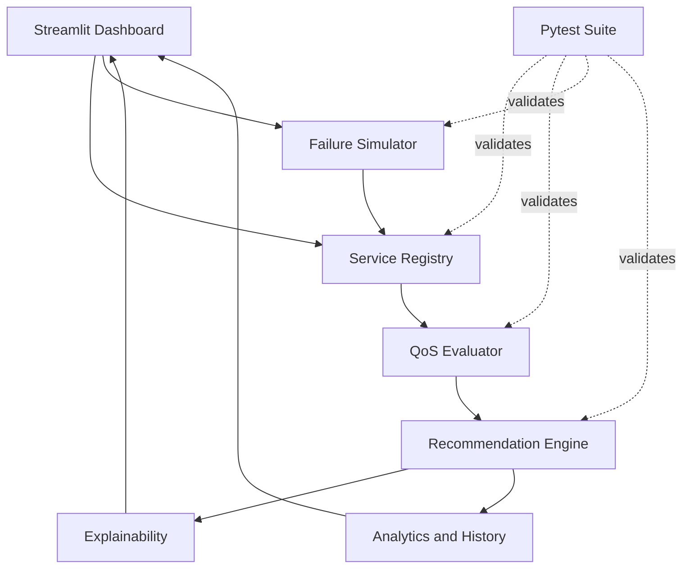
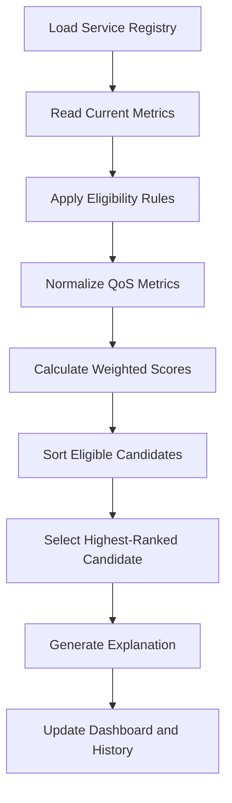

# Dynamic Cloud Failure Detection and QoS-Aware Service Reselection

<p align="center">
  <strong>An Explainable, QoS-Driven Cloud Service Reselection Simulation</strong><br>
  Academic Major Project Demonstration Prototype
</p>

<p align="center">
  
  
  
  
</p>

Inspired by the IEEE ICIMIA-2025 paper, _A Hybrid Deep Reinforcement and Swarm Optimization Strategy for Intelligent Cloud Service Composition_.

---

## Table of Contents

1. [Executive Summary](#1-executive-summary)
2. [Problem Definition](#2-problem-definition)
3. [Objectives and Features](#3-objectives-and-features)
4. [System Architecture](#4-system-architecture)
5. [Recommendation Lifecycle](#5-recommendation-lifecycle)
6. [QoS Evaluation Model](#6-qos-evaluation-model)
7. [Failure Simulation](#7-failure-simulation)
8. [Explainability and Auditability](#8-explainability-and-auditability)
9. [Technology Stack](#9-technology-stack)
10. [Repository Structure](#10-repository-structure)
11. [Installation and Execution](#11-installation-and-execution)
12. [Testing and Validation](#12-testing-and-validation)
13. [Demonstration Scenarios](#13-demonstration-scenarios)
14. [Implementation Status](#14-implementation-status)
15. [Limitations](#15-limitations)
16. [Development Roadmap](#16-development-roadmap)
17. [Research Scope](#17-research-scope)
18. [Contribution Guidelines](#18-contribution-guidelines)

---

## 1. Executive Summary

Cloud applications depend on services whose performance and availability can change at runtime. A service that is initially the best candidate may become unsuitable after a latency spike, availability reduction, reliability degradation, or complete outage.

**Dynamic Cloud Failure Detection and QoS-Aware Service Reselection** is a modular Python simulation prototype. It evaluates candidate cloud services using Quality of Service (QoS) metrics, simulates operational failures, and recommends the highest-ranked eligible service. Its Streamlit dashboard exposes service conditions, recommendation changes, comparison charts, decision explanations, and event history.

The current implementation uses deterministic QoS scoring and ranking. It is an academic simulation, not a production cloud orchestrator and not a trained deep reinforcement learning (DRL) or particle swarm optimization (PSO) system.

## 2. Problem Definition

### Background

Static service selection can become unsuitable when a selected service experiences degradation or an outage. Without reassessment, an application may continue to rely on a service whose current performance is no longer desirable.

### Problem Statement

The project explores how a service-selection mechanism can reassess candidate services after simulated operational changes, exclude unavailable services, and recommend an alternative using QoS-based ranking.

### Proposed Approach

A synthetic service registry supplies candidate services and baseline metrics. A QoS evaluator calculates comparable scores, a failure simulator changes service conditions, and a recommendation engine re-ranks candidates. The dashboard presents the result and its explanation.

## 3. Objectives and Features

- Represent candidate cloud services with QoS attributes.
- Evaluate latency, cost, availability, and reliability.
- Use baseline-anchored normalization for score comparability.
- Calculate weighted aggregate QoS scores.
- Rank candidates deterministically.
- Simulate latency spikes, availability reductions, and total outages.
- Exclude services marked `UNAVAILABLE`.
- Re-evaluate recommendations after simulated changes and Streamlit interactions.
- Explain selection changes and candidate exclusions.
- Visualize QoS metrics, service health, and simulation history.
- Validate core logic through automated tests.

### Current eligibility boundary

Unavailable services are excluded from recommendations. Configurable hard SLA thresholds for maximum latency, minimum availability, and minimum reliability were identified as missing in the latest audit. Until those are implemented and verified, a degraded service may remain eligible if it still ranks highest under the current scoring rules.

## 4. System Architecture

### High-Level Component Diagram



### Component Responsibilities

| Component                      | Responsibility                                                                         |
| ------------------------------ | -------------------------------------------------------------------------------------- |
| `app.py`                       | Streamlit interface, KPI cards, controls, service tables, and Plotly charts.           |
| `src/service_registry.py`      | Maintains synthetic service records and baseline QoS values.                           |
| `src/qos_evaluator.py`         | Normalizes QoS metrics, validates weights, and calculates aggregate scores.            |
| `src/failure_simulator.py`     | Simulates latency spikes, availability reductions, outages, restoration, and reset.    |
| `src/recommendation_engine.py` | Applies current eligibility rules, ranks candidates, and returns recommendations.      |
| `src/explainability.py`        | Generates human-readable selection and exclusion explanations.                         |
| `src/analytics.py`             | Provides health classification, analytics, history tracking, and simulation snapshots. |
| `tests/`                       | Contains automated tests for core application logic.                                   |

### Recommendation Data Flow



The current eligibility step excludes unavailable services. Strict configurable SLA filtering is a planned phase, not a verified current capability.

## 5. Recommendation Lifecycle

1. **Initialize:** Load synthetic services and baseline metrics.
2. **Evaluate:** Normalize QoS metrics and calculate weighted scores.
3. **Rank:** Order candidates using the recommendation engine.
4. **Recommend:** Return the highest-ranked eligible service.
5. **Simulate:** Apply a latency spike, availability reduction, or outage.
6. **Re-evaluate:** Recalculate scores and ranking after the simulated change.
7. **Explain:** Show why the recommendation was retained or changed.
8. **Record:** Preserve event and simulation history for inspection.
9. **Restore:** Restore a service or reset the simulation to baseline.

The current monitoring flow is reactive to Streamlit interactions and reruns. It is not a continuously running autonomous monitoring service.

## 6. QoS Evaluation Model

### Evaluated Metrics

| Metric       | Direction        | Meaning                            |
| ------------ | ---------------- | ---------------------------------- |
| Latency      | Lower is better  | Lower response delay is preferred. |
| Cost         | Lower is better  | Lower service cost is preferred.   |
| Availability | Higher is better | Higher availability is preferred.  |
| Reliability  | Higher is better | Higher reliability is preferred.   |

### Baseline-Anchored Normalization

The evaluator uses fixed baseline reference bounds so that a change in one candidate does not redefine the normalization range for unaffected candidates.

For a higher-is-better metric:

\[
N(x) = \frac{x-x*{\min}}{x*{\max}-x\_{\min}}
\]

For a lower-is-better metric:

\[
N(x) = \frac{x*{\max}-x}{x*{\max}-x\_{\min}}
\]

The implementation includes safeguards for equal bounds and weight validation. Refer to `src/qos_evaluator.py` for the exact configured bounds and implementation details.

### Weighted Aggregate Score

\[
QoS(s) = \sum\_{i=1}^{k} w_i \cdot N_i(s)
\]

Where \(s\) is a service, \(N_i(s)\) is its normalized value for metric \(i\), and \(w_i\) is the corresponding metric weight.

Use the actual weights and reference bounds in the source code as the authoritative configuration. Do not report assumed weights as experimental settings.

### Deterministic Ranking

The latest audit documented ranking by:

1. Descending aggregate QoS score.
2. Ascending `service_id` when scores are tied.

This provides repeatable ranking when service metrics and configuration remain unchanged.

## 7. Failure Simulation

| Event                  | Simulated change                               | Expected effect                                       |
| ---------------------- | ---------------------------------------------- | ----------------------------------------------------- |
| Latency spike          | Increases service latency.                     | Reduces its latency contribution to the QoS score.    |
| Availability reduction | Lowers availability.                           | Reduces its availability contribution.                |
| Total outage           | Sets status to `UNAVAILABLE`.                  | Excludes the service from recommendation candidates.  |
| Restore                | Returns service to baseline operational state. | Allows it to be considered again under current rules. |
| Global reset           | Resets simulated state.                        | Returns the environment to its baseline state.        |

The latest audit reported idempotent restoration and reset behavior without baseline drift.

## 8. Explainability and Auditability

The project is designed to expose the reasoning behind a recommendation rather than displaying only a service identifier.

Reported capabilities include:

- Selected-service identification.
- QoS score comparisons.
- Margin over the runner-up, where available.
- Reasons for recommendation changes.
- Exclusion explanations for unavailable candidates.
- Chronological simulation history.
- Before-and-after comparisons of service conditions.

At present, exclusion explanations reflect the current rules, particularly unavailable-service exclusion. SLA-specific violation explanations depend on the planned hard-SLA implementation.

## 9. Technology Stack

| Technology           | Role                             |
| -------------------- | -------------------------------- |
| Python 3.10+         | Application and simulation logic |
| Streamlit            | Interactive dashboard            |
| Pandas               | Tabular data handling            |
| NumPy                | Numerical operations             |
| Plotly Express       | Interactive visualizations       |
| Plotly Graph Objects | Custom charts                    |
| Pytest               | Automated testing                |

## 10. Repository Structure

This is a logical overview of the main modules. Confirm exact filenames against the current repository before treating it as a complete inventory.

```text
Dynamic-Cloud-Failure-and-QoS-Simulation/
├── app.py
├── requirements.txt
├── README.md
├── .gitignore
├── src/
│   ├── __init__.py
│   ├── service_registry.py
│   ├── qos_evaluator.py
│   ├── recommendation_engine.py
│   ├── failure_simulator.py
│   ├── analytics.py
│   └── explainability.py
└── tests/
    ├── __init__.py
    └── test_*.py
```

## 11. Installation and Execution

### Prerequisites

- Python 3.10 or later.
- Git, if cloning the repository.
- PowerShell for the Windows commands below.

### Clone and enter the project

```powershell
git clone <YOUR_REPOSITORY_URL>
cd Dynamic-Cloud-Failure-and-QoS-Simulation
```

Replace `<YOUR_REPOSITORY_URL>` with the actual repository URL.

### Create and activate a virtual environment

```powershell
python -m venv .venv
.\.venv\Scripts\Activate.ps1
```

### Install dependencies

```powershell
python -m pip install --upgrade pip
python -m pip install -r requirements.txt
```

If activation is unavailable:

```powershell
.\.venv\Scripts\python.exe -m pip install -r requirements.txt
```

### Run the dashboard

```powershell
python -m streamlit run app.py
```

Or:

```powershell
.\.venv\Scripts\streamlit.exe run app.py
```

Open the local URL printed in the terminal. The default Streamlit address is:

`http://localhost:8501`

Stop the server with `Ctrl+C`.

## 12. Testing and Validation

Run the full test suite from the project root:

```powershell
python -m pytest -v
```

For a concise summary:

```powershell
python -m pytest -q
```

### Latest audit-reported test status

The latest audit available for this README revision reported **29 backend unit tests passing (29/29)**:

| Test area             | Reported tests |
| --------------------- | -------------: |
| QoS evaluator         |              9 |
| Recommendation engine |              6 |
| Failure simulator     |              6 |
| Explainability        |              5 |
| Analytics             |              3 |
| **Total**             |         **29** |

These are audit-reported results, not a fresh test run performed while editing this README. Run the commands above to verify the current checkout.

### Known test gaps

The latest audit identified incomplete coverage for:

- Streamlit UI and session-state workflows.
- Some invalid and NaN boundary inputs.
- Broader end-to-end integration across the dashboard.

## 13. Demonstration Scenarios

### Scenario A — Baseline Recommendation

1. Start the dashboard.
2. Select a service category.
3. Review the registered service metrics.
4. Compare latency, cost, availability, and reliability.
5. Inspect the selected service and its explanation.

Expected observation: the engine identifies the highest-scoring candidate among services eligible under the current rules.

### Scenario B — Latency Degradation

1. Select the currently recommended service.
2. Inject a latency spike.
3. Observe the updated latency and QoS score.
4. Inspect the candidate ranking.
5. Review whether the recommendation changes.

Expected observation: the degraded service receives a lower latency contribution. Reselection occurs if another eligible candidate becomes the highest-ranked candidate.

### Scenario C — Total Outage

1. Select the currently recommended service.
2. Trigger the outage simulation.
3. Confirm its status becomes `UNAVAILABLE`.
4. Inspect the updated recommendation.
5. Review the exclusion explanation.

Expected observation: the unavailable service is excluded and the best remaining eligible candidate is recommended, if one exists.

### Scenario D — Category-Wide Outage

1. Simulate outages for each service in the selected category.
2. Observe the recommendation after each event.
3. Confirm unavailable candidates are not selected.
4. Verify that the dashboard handles the no-available-candidate state.

### Scenario E — Restoration

1. Restore an individual service.
2. Confirm its operational state returns to normal.
3. Check whether it re-enters the ranking.
4. Reset all services.
5. Verify that the baseline state is restored.

## 14. Implementation Status

This table reflects the latest audit report available when this README was prepared. It is not a substitute for inspecting the current source code and running the tests.

| Area                   | Audit status | Notes                                                           |
| ---------------------- | ------------ | --------------------------------------------------------------- |
| QoS evaluation         | Implemented  | Latency, cost, availability, and reliability.                   |
| Baseline normalization | Implemented  | Fixed reference bounds.                                         |
| Deterministic ranking  | Implemented  | Score ordering and service-ID tie-break.                        |
| Outage exclusion       | Implemented  | `UNAVAILABLE` services are excluded.                            |
| Failure simulation     | Implemented  | Latency, availability, outage, restore, and reset.              |
| Dynamic reselection    | Partial      | Re-evaluation occurs on Streamlit interactions/reruns.          |
| Explainability         | Implemented  | Reasons for decisions under current rules.                      |
| Analytics              | Implemented  | Ten Plotly visualization components reported by audit.          |
| Hard SLA filtering     | Pending      | Configurable latency, availability, and reliability thresholds. |
| Continuous monitoring  | Pending      | Current monitoring is reactive/event-driven.                    |
| Hysteresis             | Pending      | Anti-flapping behavior is not implemented.                      |
| Manual override        | Pending      | User pinning/override is not implemented.                       |
| UI automation tests    | Incomplete   | Dashboard/session-state coverage needs strengthening.           |

## 15. Limitations

1. **Synthetic environment:** All services and failure events are simulated.
2. **No live cloud integration:** The prototype does not invoke provider APIs or provision infrastructure.
3. **Reactive monitoring:** Re-evaluation is tied to Streamlit interactions and reruns.
4. **No hard SLA enforcement yet:** A degraded service may remain eligible if it still ranks highest.
5. **No hysteresis:** Repeated switching prevention has not been implemented.
6. **Single-service selection:** The current scope selects one service from a functional category rather than composing an entire multi-service workflow.
7. **No trained DRL/PSO model:** The current engine uses deterministic weighted scoring.
8. **Limited UI test coverage:** Backend tests do not fully validate dashboard interaction flows.

## 16. Development Roadmap

Implement and verify each phase independently. Do not mark a phase complete based only on a plan or an audit statement.

| Phase | Focus                                               | Completion evidence                                                                                                            |
| ----- | --------------------------------------------------- | ------------------------------------------------------------------------------------------------------------------------------ |
| 1     | Configurable SLA constraints and strict eligibility | Central threshold configuration, hard filtering, explicit exclusion reasons, no-SLA-compliant-service state, regression tests. |
| 2     | Hysteresis and anti-flapping                        | Defined switching policy, deterministic behavior, tests for repeated ranking changes.                                          |
| 3     | Periodic monitoring                                 | Controlled monitoring cycle suitable for Streamlit, observable updates, lifecycle tests.                                       |
| 4     | Manual override and UI validation                   | Explicit override behavior, safe interaction with automatic recommendations, UI/session-state tests.                           |

### Phase 1 Acceptance Criteria

A service violating any configured hard SLA threshold must never be selected, even if its aggregate QoS score is the highest. If no service satisfies the eligibility rules, the system must report **No SLA-Compliant Service Available** and must not fall back to a violating service.

## 17. Research Scope

This prototype is inspired by research into intelligent cloud service composition and hybrid optimization. Its current implementation demonstrates deterministic QoS evaluation, failure simulation, and service reselection concepts.

It must not be presented as:

- A reproduction of the reference paper's experimental results.
- A trained DRL implementation.
- A PSO-based optimization implementation.
- A production-ready cloud orchestrator.
- A live cloud failure detection platform.

Possible future research directions include multi-cloud service composition, dependency-aware workflows, correlated failure simulation, proactive SLA prediction, and learning-based selection policies. These are outside the current verified implementation.

## 18. Contribution Guidelines

When extending the project:

1. Inspect the relevant modules and tests before changing behavior.
2. Keep service state, QoS evaluation, ranking, and dashboard presentation separated.
3. Preserve deterministic behavior unless a change is explicitly required.
4. Avoid changing scoring weights or normalization while implementing unrelated features.
5. Add tests for normal cases, edge cases, and regression behavior.
6. Run the complete test suite after each implementation phase.
7. Update this README only after functionality has been implemented and verified.
8. Clearly distinguish implemented capabilities from planned work.

---

## Project Information

- **Project:** Dynamic Cloud Failure Detection and QoS-Aware Service Reselection
- **Type:** Academic Major Project Demonstration Prototype
- **Language:** Python
- **Dashboard:** Streamlit
- **Visualization:** Plotly
- **Testing:** Pytest
- **Data:** Synthetic
- **Research inspiration:** IEEE ICIMIA-2025 paper on hybrid deep reinforcement learning and swarm optimization for intelligent cloud service composition
